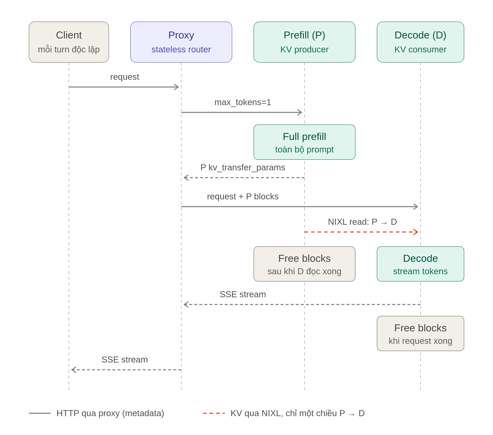

# Bài 03 — PD disaggregation + DSpark trên 1 GPU

**Mục tiêu.** Tách prefill và decode thành hai engine vLLM (P và D) cùng chạy
trên **một GPU** chia đôi bằng KAI Scheduler + HAMi-core, bắt KV đi P → D qua
`cuda_ipc`, rồi đo và so với bài 02 để hiểu PD giúp được gì và mất gì khi chỉ có
một card.

**Thời gian.** 60–90 phút: kiểm tra hạ tầng 5 phút, demo HAMi-core 15 phút, deploy
5–10 phút, quét concurrency ~35 phút.

## Kiến thức nền

Ở bài 02, một engine vLLM vừa prefill (đọc prompt) vừa decode (sinh token).
Bài này tách hai việc đó ra hai engine riêng, **cùng chạy trên một GPU**:

- **Prefill (P)** tính KV cache cho prompt rồi gửi KV sang D qua NIXL.
- **Decode (D)** nhận KV và sinh token, có DSpark như bài 02.
- **Router** nhận request của client và điều phối P → D.



Một GPU được chia cho P và D bằng **KAI Scheduler + HAMi-core**:

- [KAI Scheduler](https://github.com/NVIDIA/KAI-Scheduler) đọc annotation
  `gpu-memory` của pod, chọn card và ghi giới hạn `CUDA_DEVICE_MEMORY_LIMIT`.
- [HAMi-core](https://github.com/Project-HAMi/HAMi-core), do
  `kai-resource-isolator` nạp vào container bằng `LD_PRELOAD`, **thực thi** giới
  hạn đó: chặn cấp phát vượt slice, và cho `nvidia-smi` báo dung lượng slice thay
  vì cả card.

| Pod | Vai trò | Cổng | GPU |
|---|---|---|---|
| `vllm-g4-pd1-prefill` | `kv_producer` | 8001 | `gpu-memory: 46000` (0,47 card) |
| `vllm-g4-pd1-decode` | `kv_consumer` | 8002 | `gpu-memory: 46000` (0,47 card), **không** có HAMi-core (xem dưới) |
| `vllm-g4-pd1` | `vllm-router` | 30000 | không |

Client chỉ gọi vào Service `vllm-g4-pd1:30000`.

P và D phải là **hai pod**, không phải hai container trong một pod: KAI cấp slice
theo pod, còn isolator chỉ inject HAMi-core vào container **index 0**. Container
GPU thứ hai trong cùng pod sẽ chạy không có giới hạn nào.

**Vì sao D không có HAMi-core.** Ở mỗi lần nhận KV, UCX register rồi deregister
host buffer. HAMi-core (isolator 1.1.0) trừ bộ nhớ nhiều hơn lượng đã cộng, bộ
đếm âm rồi tràn qua uint64 và từ chối mọi lần cấp phát:

```text
HAMI-core ERROR allocator.c:52: Device 0 OOM 18446742616772051968 / 49267343360
UCX  ERROR cuMemHostRegister_v2(...) failed: out of memory
```

Đã đo: D chết ở c=8, kéo P chết theo. Vì vậy pod D mang nhãn
`kai-resource-isolator.io/webhook: ignore`. KAI vẫn đặt chỗ 0,47 card cho D, còn D
tự giới hạn bằng `--gpu-memory-utilization=0.42` **của cả card**. P vẫn có HAMi-core.

### KV đi thẳng trong GPU bằng `cuda_ipc`

Mỗi request 8k token tạo ra **~330 MB KV** mà P phải chuyển sang D. P và D nằm
trên cùng một card, nên cách nhanh nhất là chép thẳng trong VRAM bằng CUDA IPC.
Nhưng mặc định NIXL/UCX lại đi đường vòng: từ GPU ra host, qua TCP, rồi vào lại
GPU.

| Đường đi của KV | Thời gian chuyển ~300 MB | Kết quả |
|---|---|---|
| TCP (mặc định khi P và D là hai pod) | 0,9 s khi rảnh, **15–40 s khi tải cao** (8–22 MB/s) | TTFT 27 s ở c=24, 157 s ở c=128 |
| **`cuda_ipc`** (cấu hình của bài) | **~6 ms** khi rảnh, trung bình 70 ms khi chạy sweep | TTFT 2 s ở c=24 |

Để UCX chọn `cuda_ipc`, `deployment.yaml` có ba thay đổi:

| Cấu hình | Vì sao |
|---|---|
| `hostNetwork`, `hostIPC`, `hostPID` cho P và D | UCX chỉ dùng `cuda_ipc` giữa hai process mà nó coi là cùng một máy (so hostname và MAC), và khi process này mở được CUDA IPC handle của process kia |
| `UCX_CUDA_IPC_ENABLE_GET_ZCOPY=y` | **Nguyên nhân chính.** Không có NVLink thì UCX tắt thao tác *get* qua `cuda_ipc` (log: `cuda-ipc get zcopy disabled as no nvlinks detected`), mà NIXL lại dùng *get* để D kéo KV. Điều kiện này dành cho hai GPU nối qua PCIe, không đúng khi P và D ở cùng một card |
| D dùng port NIXL 5601 (P dùng 5600), cộng `podAffinity` theo P | Chạy `hostNetwork` thì hai pod không được trùng port, và D phải nằm cùng node (cùng card) với P |

Đánh đổi: P và D dùng network, IPC và PID của node. Các port 8001, 8002, 5600,
5601 trên node phải còn trống.

## Trước khi bắt đầu

- Đã làm xong [bài 01](../01-gemma4-baseline-agg/README.md) và [bài 02](../02-gemma4-spec-dspark/README.md).
- Đã xoá deployment của bài 02 để trả GPU: `kubectl delete deploy vllm-g4-spec -n token-factory`.

```bash
kubectl get pods -n token-factory | grep vllm || echo "GPU rảnh"
cd 03-gemma4-pd-spec
```

**Mong đợi:** dòng `GPU rảnh`. Nếu còn pod `vllm-g4-*` của bài trước, xoá chúng
trước: slice của P và D chỉ đặt được khi card còn trống.

## Bước 1 — Kiểm tra KAI Scheduler + HAMi-core

Đây là việc của người quản trị cụm, làm một lần cho cả cụm. Học viên chỉ cần
chạy các lệnh kiểm tra:

```bash
helm list -A | grep -E 'kai-scheduler|kai-resource-isolator'
kubectl -n kai-scheduler get deploy admission \
  -o jsonpath='{.spec.template.spec.containers[0].args}' | tr ',' '\n' | grep -E 'sharing|hami'
kubectl get queue fpt-transform-lab
kubectl get ns token-factory --show-labels
```

**Mong đợi:**

- `kai-scheduler` v0.17.1 và `kai-resource-isolator` 1.1.0 đều `deployed`.
- Có `--gpu-sharing-enabled=true` và `--hami-core-enabled=true`.
- Queue `fpt-transform-lab` tồn tại.
- Namespace **không** có nhãn `kai-resource-isolator.io/webhook=ignore`. Nếu có,
  webhook sẽ bỏ qua mọi pod của lab và pod chạy không giới hạn.

<details>
<summary>Quản trị viên: cài từ đầu (cần cluster-admin)</summary>

Cụm phải dùng device plugin của GPU Operator. Nếu đã cài HAMi chart đầy đủ
(`helm -n kube-system list | grep hami`) thì gỡ trước, vì HAMi tắt device plugin
của node mà KAI lại cần nó:

```bash
helm -n kube-system uninstall hami
kubectl label node <node> gpu- nvidia.com/gpu.deploy.device-plugin=true --overwrite
```

Cài KAI và isolator. Trong lúc `admission` khởi động lại (~15–30 giây), việc
**tạo pod mới** trên toàn cụm sẽ bị chặn. Pod đang chạy không bị ảnh hưởng.

```bash
helm upgrade --install kai-scheduler oci://ghcr.io/kai-scheduler/kai-scheduler/kai-scheduler \
  -n kai-scheduler --create-namespace --version v0.17.1 \
  --set global.gpuSharing=true --set binder.plugins.hamicore.enabled=true

helm upgrade --install kai-resource-isolator oci://docker.io/projecthami/kai-resource-isolator \
  --version 1.1.0-chart -n kai-resource-isolator --create-namespace -f kai/isolator-values.yaml

# Queue gốc KAI tạo sẵn có quota 0, chặn mọi queue con
kubectl patch queue default-parent-queue --type merge -p \
  '{"spec":{"resources":{"cpu":{"quota":-1,"limit":-1},"gpu":{"quota":-1,"limit":-1},"memory":{"quota":-1,"limit":-1}}}}'
kubectl apply -f kai/queue.yaml
```

Trên cụm dùng chung, có thể dành riêng node lab cho pod KAI. Manifest của bài đã
có sẵn toleration tương ứng:

```bash
kubectl taint nodes <node> nvidia.com/kai-dedicated=true:NoSchedule --overwrite
kubectl label node <node> fpt-transform-lab=true --overwrite
```

Taint `NoSchedule` không chặn pod reservation của KAI, vì KAI tạo pod đó với
`nodeName` cố định, không đi qua scheduler.

</details>

## Bước 1b — Demo HAMi-core (workshop)

Trước khi nạp model, làm demo 15 phút trong [hami-demo/](hami-demo/README.md):
xem một card bị chia ra sao, giới hạn bộ nhớ được thực thi thế nào, và vì sao
P/D vẫn tranh SM với nhau. **Nhớ dọn pod demo** trước khi sang Bước 2.

## Bước 2 — Deploy

```bash
kubectl apply -f deployment.yaml
kubectl rollout status deploy/vllm-g4-pd1-prefill -n token-factory --timeout=25m
kubectl rollout status deploy/vllm-g4-pd1-decode  -n token-factory --timeout=25m
kubectl rollout status deploy/vllm-g4-pd1         -n token-factory --timeout=10m
```

**Mong đợi:** ba deployment đều `successfully rolled out`. Mất khoảng 5–6 phút
(lần sau, khi cache đã ấm, ngắn hơn). D chờ P sẵn sàng rồi mới nạp model (log in
`[D] waiting for prefill...`). D thấy cả card, nên nếu nạp cùng lúc, vLLM sẽ tính
phần bộ nhớ P đang nạp vào chi phí của D: đã đo KV cache của D giảm từ 24,8 xuống
11,8 GiB.

Xác nhận hai slice nằm trên **cùng một GPU** và đã bị giới hạn:

```bash
for d in prefill decode; do
  kubectl exec -n token-factory deploy/vllm-g4-pd1-$d -- sh -c \
    'cat /etc/ld.so.preload; echo LIMIT=$CUDA_DEVICE_MEMORY_LIMIT; \
     nvidia-smi --query-gpu=uuid,memory.total,memory.used --format=csv,noheader' 2>&1 | grep -v HAMI-core
done
```

Ví dụ đã đo trên RTX PRO 6000 (UUID khác nhau theo từng card):

```text
/usr/local/vgpu/libvgpu.so
LIMIT=46985m
GPU-99e2f280-922e-94ea-4ae3-0b0a3a163b61, 46985 MiB, 42115 MiB    # prefill: chỉ thấy slice
LIMIT=46985m
GPU-99e2f280-922e-94ea-4ae3-0b0a3a163b61, 97887 MiB, ...          # decode: không có HAMi-core, thấy cả card
```

Cùng một UUID. P dùng `0.90` của **slice** (0,90 × 46 985 MiB ≈ 41 GB), D dùng
`0.42` của **cả card** (0,42 × 97 887 MiB ≈ 41 GB). Xem KV cache của từng engine:

```bash
kubectl logs -n token-factory deploy/vllm-g4-pd1-prefill | grep "GPU KV cache size"
kubectl logs -n token-factory deploy/vllm-g4-pd1-decode  | grep "GPU KV cache size"
```

Đã đo: P có 229 618 token (27,1 GiB), D có 210 005 token (24,8 GiB).

## Bước 3 — Gửi thử một request

```bash
kubectl exec -n token-factory deploy/bench-client -- curl -s \
  http://vllm-g4-pd1:30000/v1/chat/completions \
  -H 'Content-Type: application/json' \
  -d '{"model":"gemma4-12b","messages":[{"role":"user","content":"Viet ham Python tinh Fibonacci thu n. Chi code."}],"max_tokens":200}'
```

Đọc nội dung trả về: phải là câu trả lời mạch lạc có code Python, không phải
chuỗi ký tự lộn xộn. Đợi khoảng 10 giây (vLLM in metrics theo chu kỳ) rồi xác
nhận D nhận KV từ P thay vì tự prefill:

```bash
kubectl logs -n token-factory deploy/vllm-g4-pd1-decode --since=5m \
  | grep -E "External prefix cache hit rate|KV Transfer metrics" | tail -2
```

Mong đợi `External prefix cache hit rate: 100.0%` và
`KV Transfer metrics: Num successful transfers=...`.

Xác nhận KV đi trong GPU bằng `cuda_ipc` chứ không phải TCP. Request ngắn ở trên
chỉ chuyển ~8 MB nên chưa đủ để thấy khác biệt; hãy gửi một prompt khoảng 7–8k token
(cỡ prompt của SPEED-Bench):

```bash
kubectl exec -n token-factory deploy/bench-client -- python3 -c "
import json, urllib.request
body = json.dumps({'model': 'gemma4-12b', 'max_tokens': 8,
    'messages': [{'role': 'user', 'content': 'Tom tat: ' + 'xin chao the gioi. ' * 1500}]}).encode()
req = urllib.request.Request('http://vllm-g4-pd1:30000/v1/chat/completions', body,
                             {'Content-Type': 'application/json'})
print(json.load(urllib.request.urlopen(req, timeout=120))['usage'])
"
```

Đợi khoảng 10 giây, rồi đọc dòng `KV Transfer metrics` mới nhất của D:

```bash
kubectl logs -n token-factory deploy/vllm-g4-pd1-decode --since=2m | grep "KV Transfer metrics" | tail -1
```

Đọc hai trường `Avg MB per transfer` và `Avg xfer time (ms)`:

| | `cuda_ipc` (đúng) | TCP (sai) |
|---|---|---|
| `Avg MB per transfer` | khoảng 300–340 | khoảng 300–340 |
| `Avg xfer time (ms)` | vài ms đến vài chục ms | hàng trăm ms đến hàng chục giây |
| `Throughput (MB/s)` | hàng chục nghìn trở lên | dưới ~1000 |

Đã đo với prompt 9016 token: 329,9 MB trong 8,4 ms (~39 GB/s). Một lần đo khác:
339,6 MB trong 2,8 ms (~120 GB/s). Tốc độ này chỉ phép chép trong cùng một GPU mới
đạt được; TCP thì thấp hơn hai bậc. Nếu thấy thời gian chuyển lên hàng trăm ms trở lên thì KV đang
đi qua TCP (xem phần Xử lý sự cố).

## Bước 4 — Quét concurrency

```bash
kubectl delete job sweep-bench-pd1 -n token-factory --ignore-not-found
kubectl apply -f sweep-job.yaml
kubectl logs -n token-factory -f job/sweep-bench-pd1
```

Sweep mất ~35 phút; `Ctrl+C` chỉ thoát phần xem log, job vẫn chạy. Kết quả lưu ở
`/results/03-g12-pd-1gpu-kai-c*.json`, kết thúc bằng dòng
`=== xong: /results/03-g12-pd-1gpu-kai-c*.json ===`. Trong lúc chạy, xem tỉ lệ
chấp nhận của DSpark ở phía D:

```bash
kubectl logs -n token-factory deploy/vllm-g4-pd1-decode --tail=3000 | grep "Mean acceptance length" | tail -3
```

## Bước 5 — So với bài 02

```bash
BENCH=$(kubectl get pod -n token-factory -l app=bench-client -o jsonpath='{.items[0].metadata.name}')
kubectl cp ../04-compare-results/compare-spec.py token-factory/$BENCH:/tmp/compare-spec.py
kubectl exec -n token-factory $BENCH -- python3 /tmp/compare-spec.py 02-g12-dspark 03-g12-pd-1gpu-kai dspark pd
```

Kết quả đã đo trên RTX PRO 6000 (SPEED-Bench
`throughput_8k`, median). Cột so sánh là 03/02: **Gain ↑** càng cao càng tốt,
**TPOT** và **TTFT ratio ↓** càng thấp càng tốt.

| c | 02 tok/s | 03 tok/s | **Gain ↑** | 02 TPOT ms | 03 TPOT ms | **TPOT ↓** | 02 TTFT | 03 TTFT | **TTFT ↓** |
|---:|---:|---:|---:|---:|---:|---:|---:|---:|---:|
| 1 | 190 | 196 | 1.03x | 4.48 | 4.46 | 0.99x | 0.38 s | 0.45 s | 1.18x |
| 2 | 324 | 350 | 1.08x | 4.67 | 4.85 | 1.04x | 0.43 s | 0.96 s | 2.26x |
| 4 | 429 | 697 | **1.62x** | 5.00 | 4.67 | 0.93x | 0.09 s | 0.24 s | 2.68x |
| 8 | 598 | 682 | 1.14x | 5.38 | 5.25 | 0.98x | 0.30 s | 0.67 s | 2.26x |
| 16 | 1339 | 1339 | 1.00x | 6.14 | 6.39 | 1.04x | 0.76 s | 2.14 s | 2.84x |
| 24 | 1998 | 1580 | 0.79x | 7.13 | 7.50 | 1.05x | 0.83 s | 2.02 s | 2.45x |
| 32 | 2287 | 2288 | 1.00x | 7.92 | 8.20 | 1.03x | 0.50 s | 1.21 s | 2.42x |
| 48 | 2735 | 2616 | 0.96x | 10.51 | 11.25 | 1.07x | 0.65 s | 1.60 s | 2.48x |
| 64 | 3060 | 2620 | 0.86x | 12.98 | 14.70 | 1.13x | 0.89 s | 4.91 s | 5.51x |
| 96 | 3452 | 2480 | 0.72x | 18.61 | 18.49 | 0.99x | 1.29 s | 41.9 s | 32.4x |
| 128 | 3173 | 2134 | 0.67x | 26.26 | 21.70 | **0.83x** | 5.63 s | 103 s | 18.4x |

**Đọc kết quả:**

- **TPOT ngang bài 02** ở mọi mức c (0,83–1,13x). Khi đã có KV, D decode nhanh
  như một engine đầy đủ.
- **Throughput ngang hoặc hơn bài 02 đến c=48**, đỉnh 2,6k tok/s. Từ c≥64 thì
  thua (0,67–0,86x), vì đỉnh của bài 02 là 3,45k.
- **TTFT chậm hơn 1,2–2,8 lần đến c=48** (vẫn dưới 2,2 s), rồi tăng vọt từ
  c≥64. Ở mức này KV cache của D (~25 GiB, nửa card) đầy, request phải xếp hàng
  chờ D.
- So với chuyển KV qua TCP, `cuda_ipc` giảm TTFT 3–30 lần (ví dụ c=48: 52 s
  xuống 1,6 s) và tăng đỉnh throughput từ 1,7k lên 2,6k tok/s.

**Vì sao PD trên 1 GPU không thắng bài 02:**

| Nguyên nhân | Giải thích |
|---|---|
| P và D vẫn tranh nhau một card | PD sinh ra để prefill không làm chậm decode. Trên cùng một card, lúc P prefill, nó vẫn chiếm SM và băng thông bộ nhớ của D (demo đo được: hai tenant chạy cùng lúc thì mỗi bên còn khoảng nửa TFLOPS) |
| Hai bản model | P và D mỗi bên nạp riêng model và drafter, nên mỗi bước đọc weight hai lần và D chỉ còn ~25 GiB cho KV cache |
| P chỉ có nửa card | Ở bài 02, prefill dùng cả card và chạy xen với decode (chunked prefill), nên chữ đầu tiên ra nhanh hơn |
| Thêm chặng | client → router → P → chuyển KV → D, so với client → engine |

**Kết luận:** PD là kỹ thuật cho hệ thống **nhiều GPU**, khi P và D có card
riêng và có đường truyền KV nhanh (NVLink hoặc RDMA). Chia đôi một card thì tốt
nhất cũng chỉ ngang bài 02.

Câu hỏi:

- Cùng một GPU, tách P/D thắng bài 02 ở chỉ số nào và thua ở chỉ số nào?
- KV cache của D nhỏ hơn bài 02 bao nhiêu? Từ mức `c` nào request phải xếp hàng?
- TTFT của bài này gồm những chặng nào (gợi ý: xem hình ở đầu bài)?

## Cần biết khi đọc kết quả

| Điều | Ý nghĩa |
|---|---|
| D chạy không có HAMi-core | Bộ đếm của HAMi-core 1.1.0 hỏng khi chạy cùng NIXL (xem đầu bài). Nếu D vượt 0,42 card thì không có gì chặn nó lấn sang P. |
| HAMi-core chỉ giới hạn **bộ nhớ** | Không chia SM. Lúc P prefill nặng, D decode chậm lại. Demo đo được: hai tenant cùng chạy matmul thì mỗi bên còn khoảng một nửa TFLOPS. |
| `gpu-memory` bị làm tròn | KAI đổi 46000 MiB thành 0,47 card (làm tròn lên 2 chữ số), rồi giới hạn ở 0,47 × 97 887 = 46 985 MiB. Hai slice chiếm 0,94 card. |
| Chuyển KV | ~330 MB mỗi request 8k token, đi bằng `cuda_ipc` (xem đầu bài). Thời gian chuyển cộng thẳng vào TTFT; xem `Avg xfer time` trong `KV Transfer metrics` của D (đã đo trung bình 70 ms khi chạy sweep). |
| `--max-model-len=32768` | Mỗi engine chỉ có nửa card nên ngữ cảnh ngắn hơn bài 01–02 (`131072`). |
| P và D phải cùng cấu hình | `--speculative-config`, `--block-size`, `kv_connector` lệch nhau thì D trả văn bản rác mà vẫn HTTP 200. |

## Xử lý sự cố

| Hiện tượng | Nguyên nhân thường gặp | Cách xử lý |
|---|---|---|
| Pod P/D `Pending`, sự kiện `didn't have enough resources: GPU memory` | Card còn pod khác giữ: pod demo chưa dọn, hoặc deployment bài 01/02 còn chạy | `kubectl get pod -n token-factory -o wide`, xoá pod hoặc deployment cũ |
| P `Running` trên một node, D `Pending` với `didn't have enough resources: GPU memory` | P bị KAI ghép vào card đã có slice của queue khác; D phải cùng card với P nên không còn chỗ | Giữ `podAntiAffinity` của P trong `deployment.yaml`; xem `kubectl get pod -A -o wide` và `kubectl -n kai-resource-reservation get pods -o wide` để biết card nào đang bị chia |
| Pod `Pending`, `NonPreemptibleOverQuota` | Queue `fpt-transform-lab` hoặc `default-parent-queue` thiếu quota | Bước 1, phần quản trị viên |
| Pod `Pending` mãi, scheduler log `<0> PodGroupInfos` | Nhãn `kai.scheduler/queue` trỏ vào queue cha thay vì queue lá | Giữ `fpt-transform-lab` như trong `deployment.yaml` |
| `nvidia-smi` trong P/D báo cả card, không có `/etc/ld.so.preload` | Namespace có nhãn `kai-resource-isolator.io/webhook=ignore`, hoặc webhook isolator sập lúc tạo pod (fail open) | `kubectl label ns token-factory kai-resource-isolator.io/webhook-`, rồi `kubectl rollout restart` P và D |
| D báo `HAMI-core ERROR ... Device 0 OOM 1844674...` rồi `EngineDeadError` | D bị inject HAMi-core (thiếu nhãn ignore), bộ đếm tràn sau các lần chuyển KV | Giữ nhãn `kai-resource-isolator.io/webhook: ignore` trên pod D |
| P báo `CUDA out of memory` với dòng `HAMI-core ERROR ... OOM` (số hợp lý) | KV cache hoặc CUDA graph của P phình quá slice khi tải cao | Giảm `--gpu-memory-utilization` của P, hoặc tăng `gpu-memory` (tổng P + D ≤ 1,00 card) |
| KV cache của D chỉ ~12 GiB | D nạp model cùng lúc với P | Giữ vòng `until curl ... prefill` trong lệnh của D |
| Router trả `Decode policy failed to select a worker` | D vừa restart, router còn giữ trạng thái cũ | `kubectl rollout restart deploy/vllm-g4-pd1 -n token-factory` |
| `KV Transfer metrics` báo `Avg xfer time` hàng trăm ms đến hàng chục giây, log UCX có `software emulation \| tcp/...` | KV đi qua TCP: thiếu `UCX_CUDA_IPC_ENABLE_GET_ZCOPY=y`, thiếu `hostNetwork`/`hostIPC`/`hostPID`, hoặc P và D nằm khác node | Giữ nguyên `deployment.yaml`; kiểm tra `kubectl get pod -o wide` để thấy P và D cùng node |
| D `Pending`, sự kiện báo `didn't have free ports` | Port 8002 hoặc 5601 trên node đã có process khác dùng (do chạy `hostNetwork`) | Giải phóng port, hoặc đổi `--port`/`VLLM_NIXL_SIDE_CHANNEL_PORT` của D |
| `router` khởi động lại liên tục | Không cài được `vllm-router` (pod không ra được internet) | Kiểm tra mạng ra PyPI: `kubectl logs -n token-factory deploy/vllm-g4-pd1` |

## Dọn dẹp

```bash
kubectl delete -f deployment.yaml
kubectl delete -f sweep-job.yaml --ignore-not-found
```

Pod reservation của KAI tự biến mất khi slice cuối cùng trên card được giải
phóng, và card trở lại cho device plugin (bài 01/02 dùng được ngay).

---

**Tiếp theo:** [Bài 04 — Tổng hợp kết quả](../04-compare-results/README.md)
